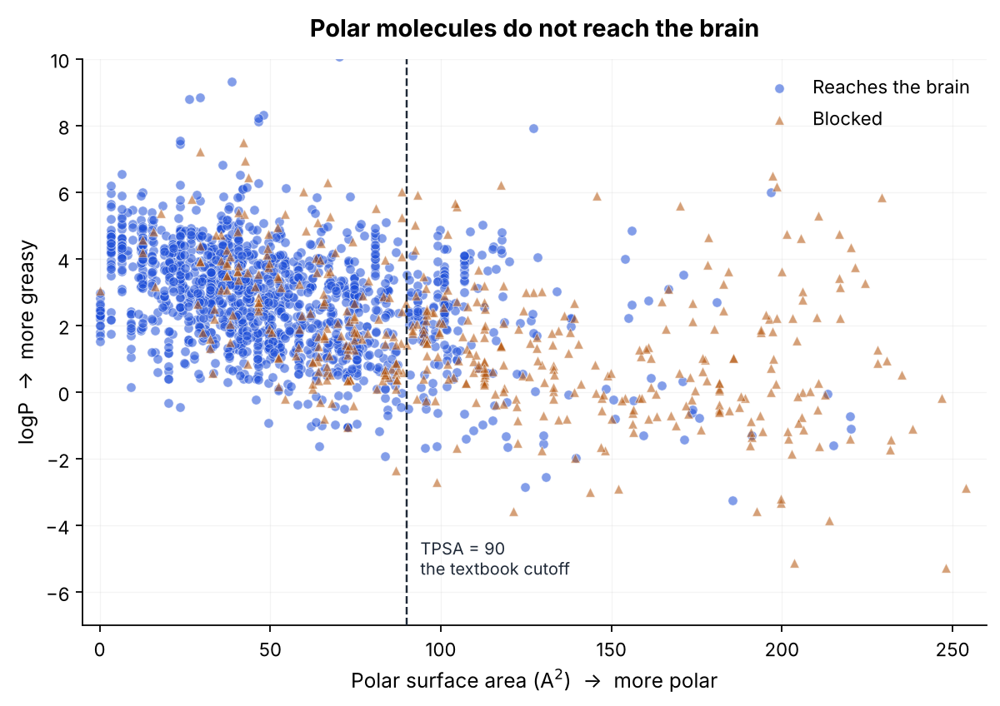
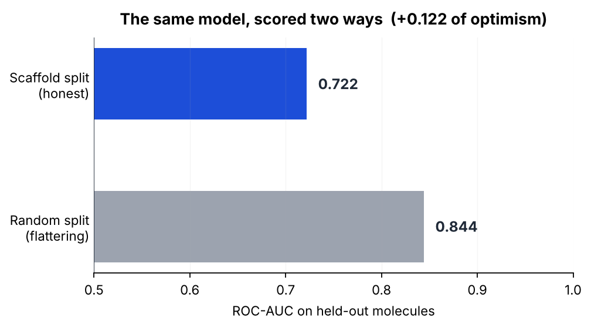

# Does this molecule reach the brain?

**Amine Ahmadi** &middot; [GitHub](https://github.com/ahmadiamine) &middot; [LinkedIn](https://www.linkedin.com/in/mohamed-amine-ahmadi-29288b2b0/)

Predicts blood–brain barrier penetration from eight molecular descriptors, on
1,935 compounds with published measurements. Logistic regression, no deep
learning — and it recovers the desolvation penalty that governs the barrier.

**[Try it in your browser →](https://ahmadiamine.github.io/bbb-predictor/)** — paste
any molecule, see it drawn, and watch the prediction form.



---

## The idea

The blood–brain barrier is a sheet of endothelial cells whose junctions are so
tight that almost nothing passes *between* them. A molecule has to go straight
*through* — dissolving into the lipid membrane on one side and out the other.

To do that it must first shed the shell of water clinging to its polar groups.
Every hydrogen bond a molecule makes with water is a bond that has to be broken
before entry. So the prediction is: **polar molecules should be excluded, and
polar surface area should matter more than anything else.**

That is testable, and the plot above is the test. The TPSA = 90 Ų line is the
textbook rule of thumb; the blocked compounds pile up to the right of it.

## What's in here

```
bbb-predictor/
├── data/
│   └── bbbp.csv               1,935 molecules, cleaned and deduplicated
├── src/
│   ├── fetch_data.py          downloads and cleans the BBBP benchmark
│   ├── features.py            molecule -> eight descriptors
│   ├── train.py               trains, splits two ways, exports the model
│   └── plot.py                makes the figures
├── tests/
│   └── test_browser_parity.py checks the website agrees with scikit-learn
├── docs/                      the website (GitHub Pages serves this folder)
│   ├── index.html
│   ├── predict.js             the model, ported to JavaScript
│   ├── model.js               generated by train.py - do not edit
│   └── vendor/                RDKit compiled to WebAssembly
└── results/                   metrics, figures, coefficients
```

## Run it

```bash
git clone https://github.com/ahmadiamine/bbb-predictor.git
cd bbb-predictor
pip install -r requirements.txt

cd src
python fetch_data.py     # downloads and cleans the benchmark
python train.py          # trains and prints everything below
python plot.py           # writes the figures
```

Takes under a minute. No GPU, no API keys.

---

## Each step, explained

### Step 1 — Get measured data, and clean it honestly

The source is the Blood–Brain Barrier Penetration (BBBP) set from MoleculeNet:
around 2,050 compounds, each labelled from published pharmacology. These are
laboratory observations, not rule-based guesses.

The raw file needs work, and the cleaning is not cosmetic:

```
read 2050 records
  32 records dropped as unparseable or out of scope
  61 duplicate entries collapsed
  11 molecules dropped for contradictory labels
→ 1935 molecules: 1485 penetrate / 450 do not (77% positive)
```

Three things happen in `fetch_data.py`, all applied identically to every record:

1. **Keep only the largest fragment.** Drugs are stored as formulated, so
   propranolol arrives as its hydrochloride salt. The chloride ion is not part
   of what crosses the barrier.
2. **Neutralise charges**, so one molecule has one representation.
3. **Re-canonicalise**, which is what makes duplicates *detectable* at all.

Only after step 3 do the 61 duplicates become visible — before canonicalisation
they are different strings. A duplicate that survives into both the training and
test sets hands the model a free correct answer. The 11 molecules carrying
contradictory labels in different source rows are dropped entirely, since there
is no principled way to pick which label is right.

### Step 2 — Turn molecules into numbers

`features.py` computes eight descriptors, each with a physical reason to matter:

| Descriptor | What it measures | Why the barrier cares |
|---|---|---|
| `tpsa` | polar surface area | water clings to polar groups and must be stripped off |
| `logp` | fat/water partitioning | too polar won't enter the membrane, too greasy won't leave it |
| `h_donors` | N–H and O–H groups | the strongest hydrogen bonds to water, the costliest to break |
| `mol_weight` | size | big molecules diffuse slowly; the practical ceiling is ~450 Da |
| `h_acceptors` | N and O atoms | polar, for the same reason as donors |
| `rotatable_bonds` | flexibility | costs entropy on entry |
| `aromatic_rings` | flat hydrophobic surface | generally helps |
| `fraction_csp3` | how 3D the carbon skeleton is | tracks with developability |

All eight come from `rdMolDescriptors`, which is the same C++ code RDKit.js runs
in the browser — that is what makes step 7 possible.

### Step 3 — Split by scaffold, not at random

**This is the step the whole project is built around.**

Drug datasets are full of close analogues: the same core ring system with a
substituent moved. Split at random and those near-twins scatter across both
sides, so the model is quietly being asked about molecules it has effectively
already seen.

So `train.py` splits both ways and reports both:

- **Random split** — shuffle, take 25% as test.
- **Scaffold split** — group by [Murcko scaffold](https://doi.org/10.1021/jm9602928)
  (the core ring system with side chains stripped), then assign *whole groups*
  to one side. 1,935 molecules reduce to 1,002 distinct scaffolds. The test set
  is chemistry the model has genuinely never encountered.

```
random split      ROC-AUC 0.844
scaffold split    ROC-AUC 0.722
gap               0.122 of pure optimism
```



Real drug discovery is always the second case — the molecule you care about is
the one nobody has made yet. **Every number quoted below is the scaffold-split
number.**

### Step 4 — Fit a logistic regression

```python
Pipeline([("scale", StandardScaler()),
          ("clf",   LogisticRegression(class_weight="balanced"))])
```

The scaler sits *inside* the pipeline so it is fitted per fold — standardising
beforehand leaks the test set's distribution into training. `class_weight=
"balanced"` matters here: 77% of the data is positive, so a model that answers
"yes" to everything scores 77% accuracy while being useless.

Logistic regression is deliberate. It cannot overfit 1,452 rows the way a forest
would, and every bit of its reasoning is readable in eight numbers.

### Step 5 — Measure against rivals, not against zero

A model is only worth deploying if it beats what people already use. Two rivals,
both scored on the same scaffold split:

```
this model (8 descriptors)   ROC-AUC 0.722   balanced accuracy 0.669
polar surface area alone     ROC-AUC 0.700
CNS rule of thumb            ROC-AUC 0.663   balanced accuracy 0.619
```

The rule of thumb is four cutoffs CNS chemists have used for decades — TPSA ≤ 90,
MW ≤ 450, logP between 1 and 4, donors ≤ 3, allowing one violation.

The honest reading: **the model wins, but not by much.** A single descriptor gets
within 0.022 of it. That is worth stating plainly rather than burying — it tells
you most of the signal here is one physical property, and that eight descriptors
are close to the ceiling of what this representation can do.

Balanced accuracy and the confusion matrix are reported alongside AUC, because
AUC alone hides *where* the errors fall:

```
confusion matrix: TN=60 FP=36 FN=111 TP=276
```

### Step 6 — Ask what it learned

```
Polar surface area     -1.645
H-bond donors          -0.700
H-bond acceptors       +0.359
logP (greasiness)      -0.204
Fraction sp3 carbons   +0.181
Rotatable bonds        -0.154
Molecular weight       -0.140
Aromatic rings         +0.112
```

Polar surface area dominates by a factor of two, pushing hard towards *blocked*.
Hydrogen bond donors come second, in the same direction.

That is the desolvation penalty, recovered from data by a model that was given
eight anonymous numbers and never told the barrier exists.

As a last check, five molecules whose behaviour is well known:

```
Caffeine (enters brain)      P(penetrates) = 0.85
Diazepam (enters brain)      P(penetrates) = 0.85
Nicotine (enters brain)      P(penetrates) = 0.94
Dopamine (blocked)           P(penetrates) = 0.49
Sucrose (blocked)            P(penetrates) = 0.02
```

Dopamine at 0.49 is the interesting failure. It is physically borderline — small
and only moderately polar — and it is excluded from the brain for reasons eight
descriptors cannot see. More on that below.

### Step 7 — Put it in front of people

`train.py` exports the scaler statistics, eight coefficients and the intercept to
`docs/model.js` — a few hundred bytes. The browser then does the rest itself:
RDKit compiled to WebAssembly parses the SMILES, computes the same descriptors,
and draws the structure; `docs/predict.js` applies the model. No server, which is
why GitHub Pages hosts it for free.

A hand-written port can quietly disagree with the model it came from, so
`tests/test_browser_parity.py` runs the JavaScript under Node and compares:

```
compared 1939 molecules
largest descriptor difference:  0.000e+00
largest probability difference: 2.220e-16
CNS rule disagreements:         0
PASS
```

The descriptors match *exactly* — zero difference, not merely small — because
RDKit.js and Python RDKit are the same C++ code compiled for two targets.

---

## Publishing the website

The site is the `docs/` folder — no build step, no framework.

1. Push the repository to GitHub.
2. **Settings → Pages**.
3. Source: **Deploy from a branch**. Branch **main**, folder **`/docs`**. Save.
4. Wait a minute. The site appears at `https://ahmadiamine.github.io/bbb-predictor/`.
5. Add that link to the repo's *About* panel.

To preview locally: `cd docs && python -m http.server 8000`.

`docs/vendor/` holds RDKit's WebAssembly build (~7 MB), vendored rather than
loaded from a CDN so the site keeps working if a CDN disappears. Swap it for
`https://unpkg.com/@rdkit/rdkit/dist/RDKit_minimal.js` if you would rather keep
the repository small.

## Honest limitations

In order of how much they matter:

1. **This models passive diffusion only.** The barrier runs active efflux pumps —
   P-glycoprotein above all — that catch molecules which got in and throw them
   back out. A compound can look perfectly permeable and be ejected anyway. No
   whole-molecule descriptor can see a transporter.
2. **Crossing is not the same as working.** L-DOPA reaches the brain by hitching
   a ride on the LAT1 amino acid transporter, not by diffusing. Dopamine itself
   cannot get in at all — which is precisely why Parkinson's disease is treated
   with the precursor rather than the drug. The model scores both on shape alone
   and gets the mechanism wrong in both directions.
3. **The labels are coarse.** A binary flag compresses a continuous quantity —
   how much gets in, and how fast — into one bit, and different source papers
   drew the line in different places.
4. **The classes are imbalanced and the sample is biased.** 77% of these
   molecules cross, because the dataset is built largely from compounds that were
   being developed for the brain in the first place. The model has seen far fewer
   examples of exclusion than of entry.
5. **Nothing here has touched a cell.** A prediction is a reason to run the
   assay, not a substitute for it.

## Possible next steps

- Add efflux-relevant features and test whether the P-glycoprotein failures shrink.
- Compare against Morgan fingerprints and a gradient-boosted model — and report
  whether the extra complexity actually buys anything over these eight numbers.
- Swap descriptors for a pretrained molecular representation (ChemBERTa, MolFormer)
  and compare against this baseline on the same scaffold split.
- Predict a continuous logBB value instead of a binary label.

## Data and references

- **BBBP dataset** — Martins et al. (2012), *J. Chem. Inf. Model.* 52:1686–1697,
  distributed as part of [MoleculeNet](https://moleculenet.org/).
- **Murcko scaffolds** — Bemis & Murcko (1996), *J. Med. Chem.* 39:2887–2893.
- **TPSA** — Ertl, Rohde & Selzer (2000), *J. Med. Chem.* 43:3714–3717.
- **Chemistry toolkit** — [RDKit](https://www.rdkit.org/), used in Python and,
  as WebAssembly, in the browser.

## License

MIT — see [LICENSE](LICENSE).
